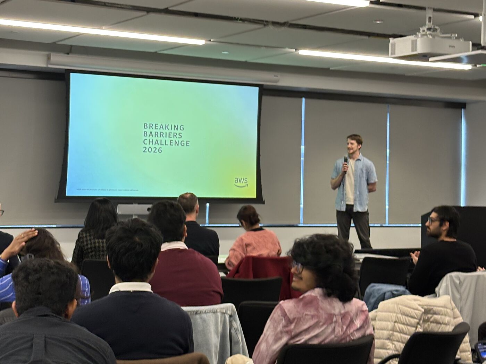
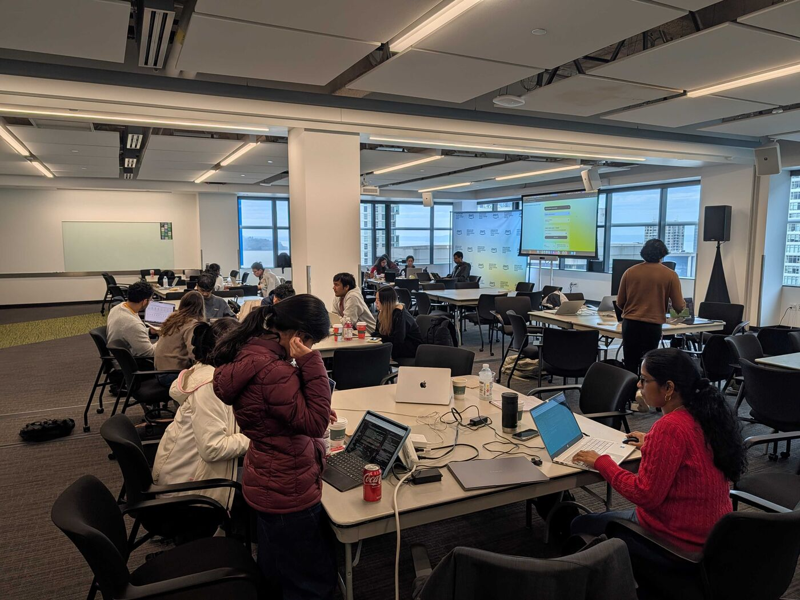
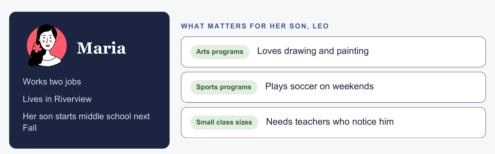
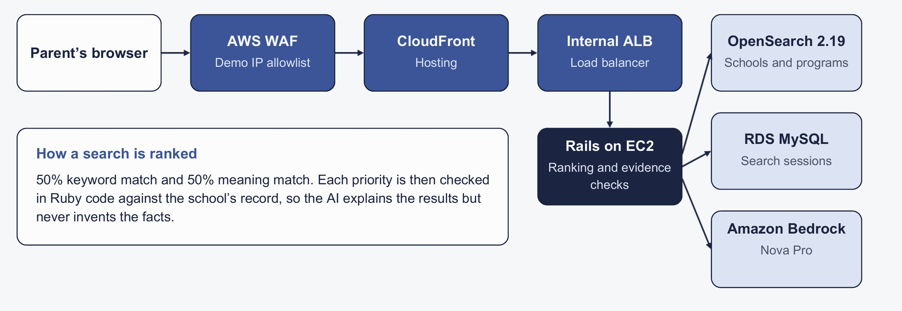

## Overview

GreatSchools is a nonprofit whose 150,000+ school profiles help about 40 million families a year choose schools. At a GreatSchools x AWS hackathon, our four-person team, **Team Atlas**, spent three days on one question: how do you turn a parent's real priorities into a list they can trust?

  
<strong>150,000+</strong>School profiles on GreatSchools

  
<strong>~40M</strong>Families who use it each year

  
<strong>3 days</strong>To build Atlas, as a team of four

## Meet Maria

We designed around one parent. Maria works two jobs and lives in Riverview. Her son Leo starts middle school next fall. He loves drawing and painting, plays soccer on weekends, and needs teachers who notice him.

At 9 PM, after her shift, her question isn't "which school has an 8/10?" It's this:

> "Where will Leo do well?"

## The problem

GreatSchools has the data. Parents still need the right terms and filters to reach it.

1. **Filters, not fit.** Parents think in sentences, but search makes them translate needs into filters and jargon like "CTE."
2. **A rating isn't a reason.** An 8/10 says how a school scores, not whether it has the arts program your kid loves.
3. **Hard to trust.** Details sit across tabs, and parents can't tell what's confirmed, outdated, or missing.

The families with the least access to clear information lose the most.

## The solution: guided search

Atlas lets parents ask in their own words.

- **Understands you.** "Middle school in Riverview with arts, sports and small class sizes" becomes priority chips the parent can edit.
- **Shows its work.** Each school card says which priorities matched, using the school's own data.
- **Guides the next step.** A school-guide chat explains why a school fits, suggests questions for a visit, and lets parents compare and save schools to a list.

### How it works

1. **Ask.** Different starting points for new and experienced parents.
2. **Understand.** Amazon Nova Pro on Bedrock extracts the parent's needs.
3. **Find and check.** OpenSearch retrieves schools and programs, and Rails checks each priority against the data.
4. **Guide.** Best-fit cards with a confidence level, a map, the school-guide chat, save and compare.

## Built on AWS

Everything runs in us-east-1. A parent's request passes through AWS WAF and CloudFront to an internal load balancer, then to a Rails app on EC2 that talks to **OpenSearch 2.19** (schools and programs), **RDS MySQL** (search sessions) and **Amazon Bedrock** (Nova Pro).

**How schools are matched:** 50% keyword match and 50% meaning match. Each priority is then checked in Ruby code against the school's record, so **the AI explains the results but never invents the facts.**

| Design goal | How we met it |
| --- | --- |
| Fast | A full search took about 2 seconds in our demo |
| Trustworthy | Facts come from GreatSchools' data and are checked in code; the model only explains |
| Light to run | Managed AWS services, so a nonprofit team runs code, not servers |

**Trade-off:** always-on infrastructure plus usage charges, including Bedrock tokens. We kept token use low by calling the model only where language understanding is needed.

## Results

We ran 20 parent-style queries against the live app. 16 had valid matches in the sample data, and 4 were expected to return none.

  
<strong>23 / 24</strong>Priorities captured per search

  
<strong>15 / 16</strong>Test queries with a relevant top result

  
<strong>54 / 54</strong>Missing or outdated data flagged correctly

  
<strong>1.98s</strong>Median search response time (2.24s average)

[Impact: what GreatSchools said, judging results, and how this could move their saves-to-searches ratio.]

## What's next

- **Now:** guided search, evidence checks, save and compare.
- **Next:** GreatSchools' full school data and reviews, side-by-side compare, and plain-language school terms.
- **Later:** saved searches that tell parents when a new matching program opens.
- **Reach goal:** an agent that calls a school to check a detail, like when soccer practice is, then shares the answer with every parent who asks. Ten parents don't have to make the same call.

## What I learned

[One or two lessons from leading product on an AI build, for example keeping the model out of the facts.]
