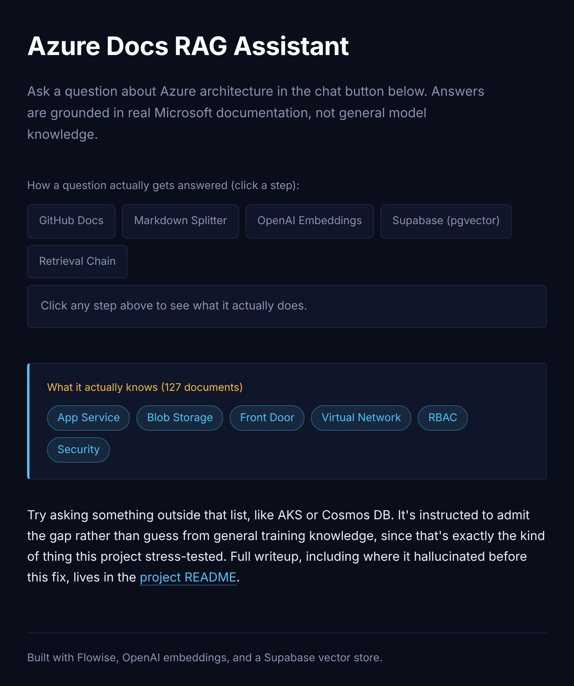
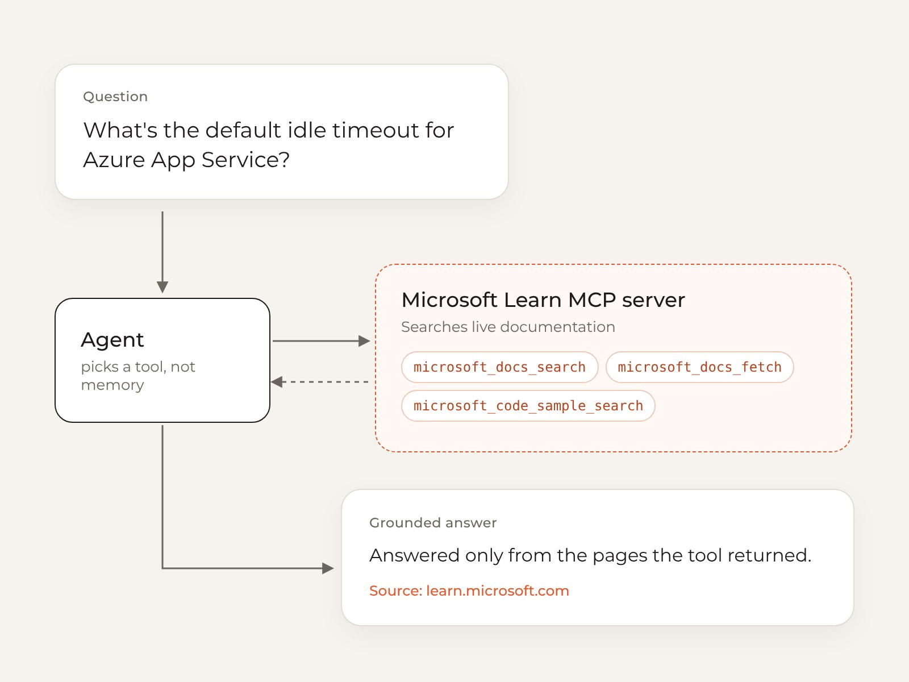

## Overview

Cloud documentation is huge, and a general chatbot will happily answer from memory, even when that memory is out of date. I wanted an assistant that answers Azure architecture questions **only from Microsoft's own documentation, and shows where every answer came from.**

I built it three times. Each version fixed the biggest gap in the one before, and the last one replaced my own retrieval pipeline with a live connection to Microsoft's documentation through the Model Context Protocol (MCP).

  
<strong>3</strong>Versions, each fixing the last one's biggest gap

  
<strong>127</strong>Curated Azure documents in the RAG version

  
<strong>6</strong>Azure services in scope, from App Service to RBAC

**Code:** [github.com/helenanguyen-dev/azure_rag](https://github.com/helenanguyen-dev/azure_rag)

## Try it live

This is the assistant running for real, on a small Python service I built as version 3. Ask it an Azure question and it searches Microsoft Learn through MCP, then answers with links to the pages it used.

  

    
Azure Docs Assistant

    
Answers come from Microsoft's documentation, with sources. Please don't type anything personal: questions go to OpenAI and Microsoft Learn to be answered.

    <button type="button" class="live-demo-button">Start the assistant</button>
    
Limited to a few questions per minute so the demo stays up for everyone.

  

## The problem

1. **Answers from memory.** A model without sources can sound sure about a setting that changed last year.
2. **No way to check.** Without a citation, a reader has to trust the summary or redo the research.
3. **A thin first version.** My first prototype, built in Langflow, turned customer notes into product requirement drafts. It proved the RAG pattern, but its knowledge base was small, its retrieval was never measured, and its guardrails were basic.

## Version 2: a curated RAG pipeline

I scoped the second version to the six Azure services I had already designed with in a cloud architecture project: App Service, Blob Storage, Front Door, Virtual Network, RBAC, and Security. That made it a tool I could test against real questions, instead of a generic "chat with your docs" demo.

- **A curated knowledge base.** 127 documents from Microsoft's open-source Azure docs (CC BY 4.0), with attribution and no edits to the source text.
- **Chunking that follows the docs.** A Markdown-aware splitter keeps each section, like "Networking" or "Security recommendations", in one piece, so a chunk answers one question well instead of half of two.
- **Tagged by service.** Every chunk carries its service name, so a question about App Service networking can search just the App Service and Virtual Network chunks.
- **A pipeline you can see.** Docs, splitter, embeddings, a Supabase vector store, then a retrieval chain, all wired up in Flowise with an embeddable chat window.

### Guardrails

- **Answer only from the retrieved context.** If a question is out of scope, like AKS or Cosmos DB, the assistant says the knowledge base doesn't cover it instead of guessing.
- **Cite every answer,** so a reader can check the original Microsoft page.
- **Decision support, not authority.** It's framed as a drafting aid, with a person reviewing anything that matters.
- **Be honest about staleness.** The corpus was a July 2026 snapshot, and the project says so openly.

## Rebuilding it on MCP

Version 2 worked, but it carried real upkeep. Someone had to choose and chunk the documents, re-ingest them when Azure changed, and engineer the metadata that made citations possible.

MCP is an open standard that lets a model call outside tools and data sources, instead of answering from what it remembers. Microsoft publishes a Learn MCP server, so I rebuilt the assistant as an agent that calls it directly.

### How it works

1. **You ask.** For example, "What's the default idle timeout for App Service?"
2. **The agent picks a tool.** It calls a documentation search instead of answering from memory.
3. **The MCP server searches Microsoft Learn** and returns current excerpts with their URLs.
4. **A grounded answer comes back,** using only what the tool returned, with the source cited.

The server offers three tools: **search** the docs, **fetch** a full page when a snippet isn't enough, and **find code samples** for a service or API.

| | Custom RAG (version 2) | MCP version |
| --- | --- | --- |
| Knowledge | 127 curated documents | Microsoft's live documentation |
| Upkeep | Choose, chunk, and re-ingest docs | No ingestion or chunking to maintain |
| Citations | Built from custom metadata | URLs come back from the tool |
| Freshness | A July 2026 snapshot | Current whenever it's asked |
| Scope | Six Azure services | Azure, Microsoft 365, Power Platform, and more |

## The trade-off

Moving to MCP was a build-versus-buy decision, not a strictly better system. I gave up control over chunking and ranking, and the assistant now depends on a server I don't run. In return, it's always current and much simpler to maintain. For a docs assistant whose whole value is being right and checkable, that trade was worth it.

## Results

[Retrieval hit rate from the evaluation set: 3 to 5 test questions per service, checking whether the right source document appeared in the top five results and whether the answer actually used it.]

## What I learned

- **Measure retrieval, not just answers.** A fluent answer can hide a bad retrieval. Planning the evaluation first changed how I chunked and tagged the documents.
- **Grounding is a product decision.** Saying "this isn't in my sources" is a feature, because trust is what makes a docs assistant useful.
- **Know what you're maintaining.** Building the pipeline myself taught me what MCP takes off your plate, and what control you give up for it.

## What's next

A from-scratch Python and LangChain version of the same pipeline, to show the mechanics that Flowise hides: custom chunking, a retrieval evaluation harness, and prompt design without a visual builder.
