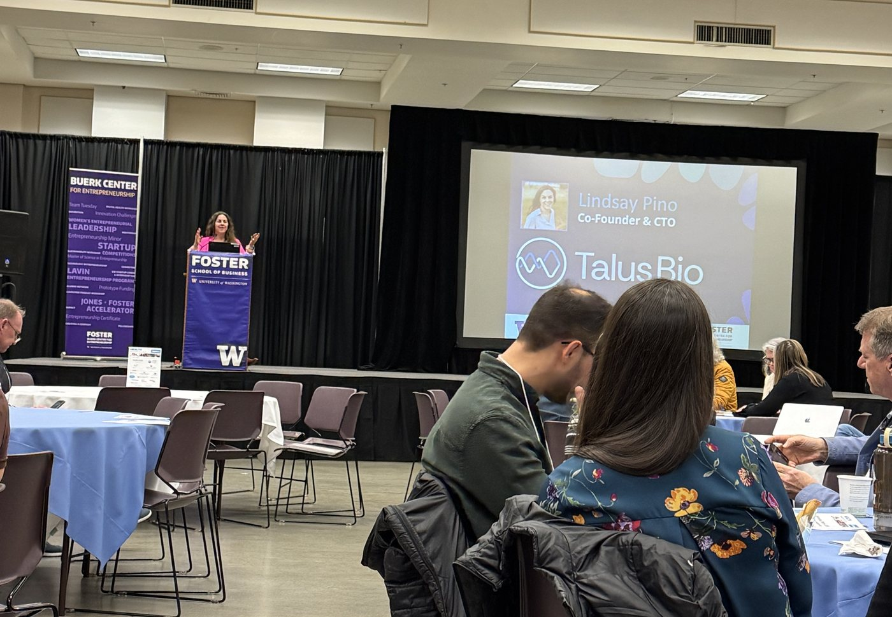

## Overview

ChitoClean is a pre-seed startup from the University of Washington. We're building a toothbrush made from chitosan, a biopolymer that comes from chitin in shellfish shells and mushrooms. When it wears out, you put it in your compost bin, not the trash.

I'm one of five co-founders. As co-Chief Product Officer (on the non-technical side) and CFO, I own product direction, the financial plan and unit economics, and the KPIs the whole team steers by.

## The problem

The plastic toothbrush has barely changed since the 1930s, and nearly every one ever made still exists. Americans throw away more than a billion a year. They can't be recycled through normal programs, and they shed microplastics for centuries.

The "green" options fall short too:

1. **Bamboo brushes** still use nylon bristles, which have to be pulled out before composting, and bamboo farming drives land use.
2. **PLA bioplastic brushes** only break down in industrial composters, which most people can't reach, so they end up in landfills anyway.

Eco-conscious shoppers end up asking whether they're just trading one environmental problem for another.

## The solution

ChitoClean is a toothbrush whose handle and bristles are both made from chitosan. It looks and feels like the brush people already use, and it breaks down in a home compost bin or garden soil.

Chitosan also brings oral-health benefits. It's naturally antimicrobial, and studies of chitosan-bristle brushes have found less gum bleeding and inflammation. It can be made from seafood waste, so the material itself is upcycled.

We're in R&D now, testing chitosan blends for durability, water resistance and how fast they biodegrade. Water resistance is the hardest part, since chitosan softens when wet.

## My role: product and the numbers

A team of scientists, engineers and business people can easily pull in three directions. My job is to tie everyone's work back to whether the business can last.

**Three KPIs for every team.** I set up one framework that every decision has to move: customer acquisition cost, cost of goods sold, and adoption rate.

**A financial plan built from the bottom up.** I built our 18-month financial plan and a unit-cost model, starting from the cost of research-grade chitosan per batch and adding labor, quality control and packaging. That model set our pricing and margins, and it showed judges and funders exactly where their money would go.

## Results

The plan helped carry ChitoClean to the finals of two UW startup challenges, including the 2026 Environmental Innovation Challenge. We were also chosen for 2026 prototype funding from UW's Buerk Center for Entrepreneurship, which pays for the R&D we're doing now.

## What I learned

**Wear many hats at once.** A five-person startup means countless meetings, conversations and disagreements. What kept us moving was a shared goal: getting a better toothbrush into the world.

**Learn what you weren't trained for.** I came in from research and product, not finance. I learned financial modeling and how supply chains work by doing them, with a lot of help from UW finance professors and the Buerk Center.

**The PM skills transfer.** Understanding the problem, understanding the people, and moving a product forward work the same way in a startup as anywhere else. ChitoClean made those skills sharper.

