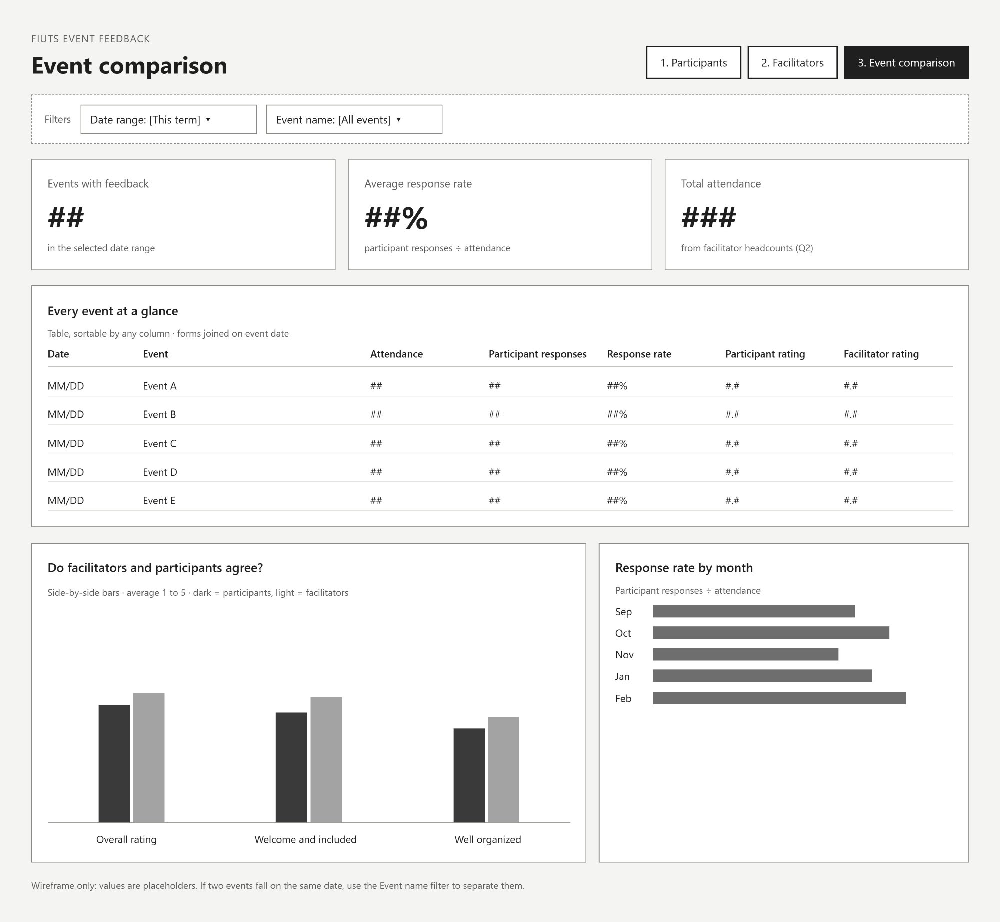

## Overview

FIUTS is a Seattle nonprofit that builds intercultural connection between international students and the wider community through trips, dinners, leadership programs and volunteering. As a data intern, I'm redesigning how FIUTS collects and uses feedback from its events, so every event can learn from the last one.

**My role:** Data Intern, working with FIUTS program staff. **Tools:** Google Forms, Google Sheets, Looker Studio.

## The problem

FIUTS runs many events a term, and people fill out feedback forms after them. Turning those answers into decisions was the hard part.

1. **Answers, but no picture.** Responses sat in spreadsheets. Seeing whether participants felt welcome, or whether a new event format was better than the old one, meant hours of manual work.
2. **Two sides of every event.** Participants and the facilitators who run events see the same event differently, and there was no way to put both views side by side.
3. **Turnover.** Staff and student roles change often. Anything that depends on one person's account, formulas or memory quietly breaks when they leave.

So the real question wasn't "what dashboard should we build?" It was **"what can a small, changing team keep running without a data person?"**

## Starting from the questions

Before choosing any charts, I wrote down what FIUTS actually needs to know, and redesigned two surveys around those questions.

**Participant survey.** How people experience an event (feeling welcome, connecting across cultures, learning something new, organization), an overall rating, whether they'd come back, how first-timers compare with returning participants, growth in four leadership areas, and what was best and what to change.

**Facilitator survey.** Whether facilitators had the information, materials, budget and staff support they needed, how the event went by role (staff, student volunteer, community volunteer), whether they'd facilitate again, and a headcount of attendees. That headcount is small but important: it's what makes response rates possible.

Every question maps to a chart. If a question didn't feed a decision, it didn't make the survey.

## Designing for zero upkeep

I chose a simple pipeline: **Google Forms → one Google Sheet → Looker Studio.** It's free, needs no installs or licenses, and updates itself as responses come in.

The design choices are about surviving turnover:

| Decision | Why |
| --- | --- |
| A shared FIUTS account owns the forms, Sheet and dashboard | Personal accounts get deleted when people leave, and everything they own goes with them |
| All calculations live inside Looker Studio | No helper tabs or formulas in the Sheet for someone to break |
| Events are filtered by the date and name people enter | No event list to maintain |
| A one-page handover note in the same folder | A new staff member can pick it up in about 10 minutes |

The only routine task left is about **15 minutes once a term**: export the dashboard to PDF and add three to five written takeaways for the termly report.

## The dashboard

Three pages, each answering one question, each with date and event filters at the top.

1. **Participant experience:** how are participants experiencing our events? Scorecards for responses, average rating and likelihood to return, agreement bars, a monthly trend, first-timers vs returning, leadership growth, and what people wrote.
2. **Facilitator support:** do our facilitators have what they need? Support and confidence by role, leadership growth, and what facilitators said worked and what they need.
3. **Event comparison:** which events work best, and do facilitators and participants agree? The two surveys are joined on event date, so every event shows attendance, response rate, and both ratings side by side.

Values in the wireframes are placeholders, not real results.

## Privacy by design

Feedback only works if people feel safe giving it, so privacy is built into the structure rather than left to good intentions.

- **No names or emails on any chart.** Facilitator names and participant interview emails stay in the raw Sheet.
- **Viewers see charts, not data.** Staff get view-only access with downloading and copying turned off.
- **A floor of five responses.** Events with fewer than five responses are hidden, so no one can be singled out.

## Where it stands

The surveys, dashboard plan and wireframes are done, and I presented them to FIUTS staff in November 2026. We're now settling the decisions that shape launch: who can view the dashboard, whether to compare event types such as trips and dinners (one dropdown on the facilitator form), whether five responses is the right floor, who writes the termly report, and whether to go live this term or start fresh next term.

[Outcome: add launch date, first response rate, or the first decision the data changed once it's live.]

## What I learned

The best data system for a small team isn't the most powerful one. It's the one that still works a year later, after everyone who built it has moved on. Starting from the questions, and designing for the person who inherits the work, mattered more than any chart.
