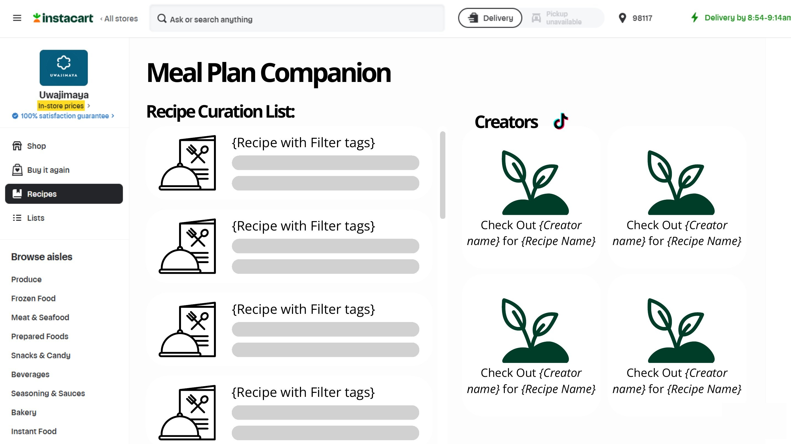
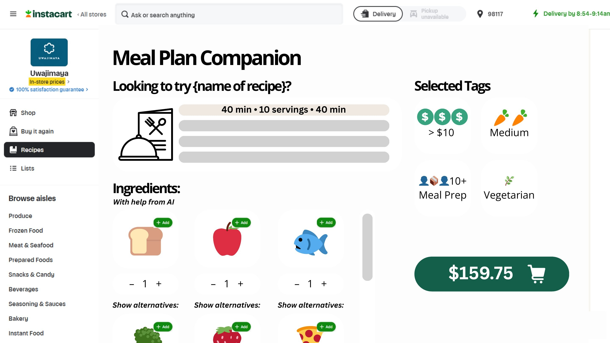
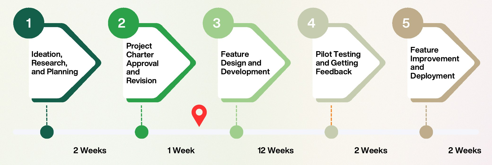

## Overview

This is a product concept, not a shipped feature. My team of four took one question through a full product cycle on paper: how might Instacart help people decide what to cook, not only what to buy? I was a product manager on the team. This page walks through how we reasoned at each step and why we made the calls we did.

## Starting from the gap

Instacart's recipes are text only, with limited search and filtering. A shopper who wants a cheap vegetarian dinner for four has no easy way to find one, and there's a gap between feeling inspired and buying the ingredients.

Before suggesting anything, I wanted to know where people already get meal ideas. The research pointed to short video. People retain much more from video than from text, food ranks among the most-watched content categories, and viewers prefer clips under two minutes. So the opportunity was to meet shoppers where their inspiration already lives and close the gap between watching and buying.

## Choosing who to build for

We focused on shoppers aged 25 to 28, who make up roughly a quarter of Instacart's users and overlap heavily with TikTok's audience. A narrow first user kept the MVP honest. Every filter and screen had to earn its place for a busy, budget-conscious person who cooks.

## Shaping the solution

An expanded Recipes tab with four steps:

1. **Set preferences.** Filter by budget per meal, difficulty, diet and serving size.
2. **Pick a video.** AI curates matching recipes, shown as short creator videos.
3. **Fill the cart.** Ingredients are matched to products at the shopper's store, with quantities and alternatives they can adjust.
4. **Check out** as usual.

I pushed to keep version 1.0 small: a limited set of filters and a curated recipe database, with deeper personalization based on purchase history saved for later releases. The riskiest assumption was that people would watch a video and then buy, so the MVP is built to test exactly that.

## Key decisions and trade-offs

  
<strong>8.25 / 10</strong>Score for the hybrid option, ahead of buy (7.25) and build (7)

  
<strong>$833K</strong>Estimated cost of the MVP

  
<strong>~4 months</strong>To launch the MVP, across five phases

**Build, buy or hybrid?** We scored all three options across eight weighted criteria, including cost, integration, data ownership, UX control and time to market. The hybrid option won (8.25 of 10, against 7.25 for buy and 7 for build). It keeps customer data and the experience in-house while reusing proven components to move faster.

**How to measure success.** I tied the OKRs to the two things the feature has to prove: that people engage (traffic, time on site, monthly active users) and that it creates value (acceptance of AI recommendations, units per order, order value).

**Is it worth it?** I sized a four-month MVP across five phases at about $833K. Then I worked backwards to what would make it pay off. If 5% of active users tried it and order value rose by about $8, it would recoup its cost within a few months. That turned a fuzzy idea into a bet we could check against real numbers.

**What could go wrong?** We built a risk register across product, engineering, security and marketing. One risk I cared about was that AI recommendations might keep surfacing the same few cuisines. We added a cuisine filter and planned ranking that favors variety, so the feature serves everyone who shops.

## Writing for engineers

I owned the user stories for the TikTok integration and revised them over three peer review sessions. My first drafts were written from the engineer's side ("As a software engineer, I want to apply dynamic filters…"). Feedback taught me that a story should describe the shopper's problem and leave the solution open for engineering to shape. The rewrite became "As a college student on a budget, I want recipes that fit my filters."

I also tightened the acceptance criteria for edge cases. If no video matches every filter, the system relaxes the match step by step, from three of four filters to half to a quarter. If TikTok is down, shoppers get a clear message and still see recipe cards.

## Planning the launch

A feature lands well only if the whole company is ready for it. The launch plan covers customer service scripts for missing ingredients and substitutions, operations checks with store partners, compliance review of creator content, dashboards for recipe-to-cart conversion, and an education plan of in-app tips and help articles.

## What I learned

- Start from where users already are, not from what the platform already has.
- Make the riskiest assumption the first thing the MVP tests.
- Turn "is it worth it?" into numbers you can argue with.
- Good user stories describe a problem. The solution comes out of the conversation with engineering.
