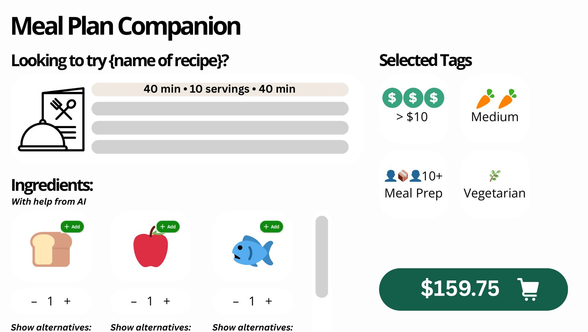

## Overview

Meal Plan Companion is a product proposal for Instacart, built with a team of four. As a product manager on the team, I helped take it from opportunity to pitch and launch plan, and I owned the user stories for the TikTok video integration.

The idea: a shopper answers a short survey about budget, diet and cooking skill, picks a recipe video that looks good, and adds every ingredient to their cart from a nearby store in one step.

## The problem

Instacart's recipes are text only, with limited search and filtering. That makes it hard for shoppers to find meals that fit their diet and budget, and it leaves a gap between getting inspired and actually buying the ingredients.

Our research pointed to video as the better format. People retain far more from video than from text, food is one of the most-watched content categories, and shoppers prefer short clips of under two minutes. We focused on users aged 25 to 28, who make up roughly a quarter of Instacart's users and overlap heavily with TikTok's audience.

## What we proposed

An expanded Recipes tab with four steps:

1. **Set preferences.** Filter by budget per meal, difficulty, dietary tags such as vegan or gluten free, and serving size.
2. **Pick a video.** AI curates matching recipes from a recipe database, shown as short creator videos.
3. **Fill the cart.** Ingredients from the chosen recipe are matched to products at the shopper's store, with quantities and alternatives they can adjust.
4. **Check out** as usual.

## How I worked

- **Strategy.** Ran a SWOT and competitor analysis, then set OKRs around engagement (site traffic, time on site, monthly active users) and order value (basket size, units per order, acceptance of AI recommendations).
- **Build vs. buy.** Scored build, buy and hybrid options across eight weighted criteria. A hybrid scored highest (8.25 of 10), because it keeps data and the UX in-house while lowering cost and time to market.
- **Sizing and business case.** Planned a four-month MVP across five phases, costed at $833K. We projected that it would pay for itself within a few months if 5% of active users adopted it and order value rose by about $8.
- **User stories.** Wrote and revised the stories for the TikTok integration epic over three peer maturation sessions. The biggest lesson was to write from the shopper's pain point rather than the engineer's task. For example, "As a college student on a budget, I want recipes that fit my filters" replaced "As a software engineer, I want to apply dynamic filters." I also added fallbacks for partial filter matches and for TikTok outages.
- **Launch plan.** Built the risk register and mitigations, including a cuisine filter so that recipe suggestions reflect diverse cultures. I also planned launch work across customer service, operations, compliance, engineering and marketing.

## Outcome

We delivered a full pitch, an MVP scope, a cost and ROI model, a risk plan and a launch plan, all ready for a go or no-go decision. This was a proposal, so the numbers above are projections and not results.

## What I learned

A good user story describes a real person's problem. The solution belongs in the conversation with engineering. Peer review caught gaps I couldn't see on my own, and I now use INVEST to check every story before it goes to the team.
